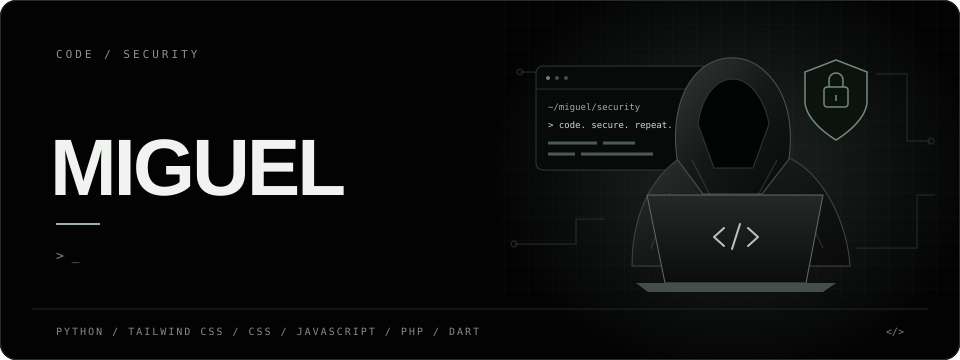
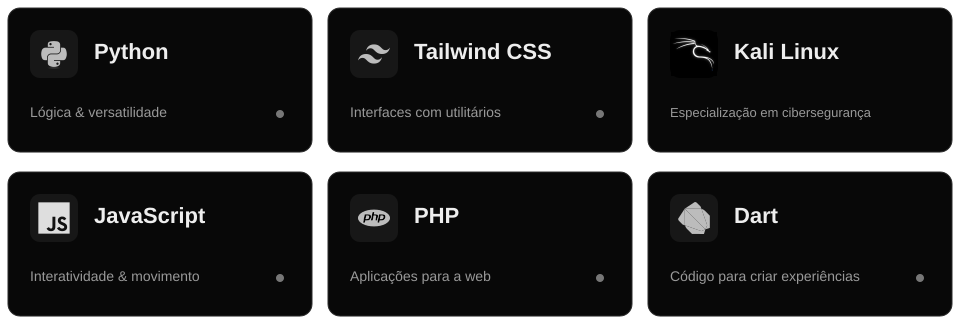

### Olá! Bem-vindo ao meu perfil 👋

Gosto de transformar ideias em código e dar forma a novas possibilidades.

**Lógica para construir. Estilo para dar vida.**

 

## Tecnologias que conheço

Minha caixa de ferramentas para programar e criar interfaces.

 

 

<!-- Ícones: Devicon (licença MIT em assets/icons/LICENSE-devicon.txt). -->
